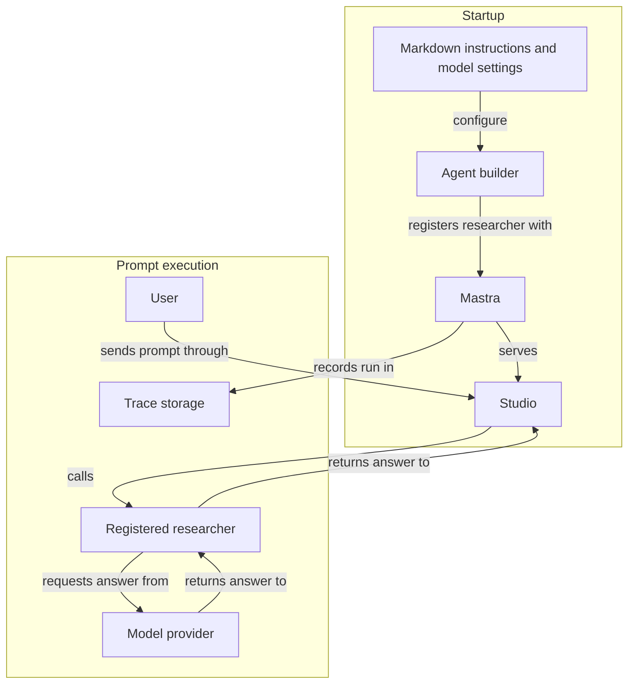

# How the researcher is organized

Application code talks to agents through a small, project-owned layer, so the agent framework can be replaced without rewriting domain code.

| Location | Responsibility |
| --- | --- |
| `agents/<agent-name>/AGENT.md` | Plain-language instructions |
| `src/agents/` | Project-owned definitions and calling interface |
| `src/mastra/` | Framework integration, model-provider checks, and tracing |

The project-owned layer names each agent, locates its instructions, and reads its model settings. It has no Mastra imports. The integration layer builds and registers Mastra agents and connects them to storage.

- `AgentRunner.generate(agentId, prompt)` resolves to the response text. Domain code receives an `AgentRunner` as a parameter, so its tests can pass a fake.
- To change frameworks, rewrite `src/mastra/`. `src/agents/` and domain code stay as they are.
- Studio, tracing, and model routing use Mastra directly in `src/mastra/`. Future workflows or memory would also belong there; neither is configured today.

## Following a request

Future application code can call the registered researcher through `AgentRunner`.

The researcher currently has no tools: it cannot browse the web, read repository files on demand, or independently retrieve sources. Supply relevant material in the prompt and verify unsupported claims.

## Extending the project

For another agent, add its instructions under `agents/<agent-name>/AGENT.md`, its definition in `src/agents/definitions.ts`, and its Mastra builder under `src/mastra/agents/`. Register it in `src/mastra/index.ts`. Keep model-provider validation and framework-specific features in `src/mastra/`.

Add domain modules when a concrete use case needs them. Future Mastra workflows belong under `src/mastra/workflows/`; they can call domain logic through the project-owned agent interface.

[Development checks](development.md) · [Back to the README](../../README.md)
