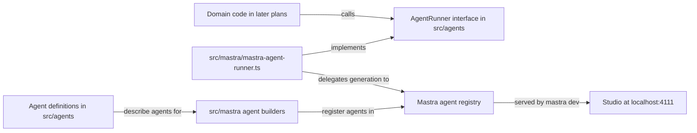

# Run one specialized researcher in Mastra Studio

## Summary

Create a small, standalone TypeScript application with one named Knowledge Researcher agent, and run it in Mastra Studio. Its identity lives in an ordinary Markdown file that is easy to inspect and edit. A thin, project-owned agent layer sits between application code and Mastra, so the agent framework can be replaced later without rewriting domain code.

## Context

This repository is a new experiment, separate from RoboRepo and youtube-transcript-cli. Mastra is the initial agent runtime, but the project owns its agent instructions, agent definitions, and domain types.

Current state of the repository:

- It contains plan documents under `docs/plans/` and a `.gitignore` that ignores `.DS_Store`. There is no `package.json`, source code, README, or test setup.
- No agent application has been run locally.

This plan is the root of the backlog. Later plans build on what it creates:

| Later plan | Relies on from this plan |
| --- | --- |
| Use the existing YouTube CLI as a safe transcript tool (`12v3ljqo`) | `src/` layout, `README.md`, a working test command |
| Turn one transcript into verifiable research findings (`w6j1t8pq`) | `agents/knowledge-researcher/AGENT.md`, and the `AgentRunner` boundary for calling the researcher |
| Compare technologies using current primary sources (`pkxml601`) | The `agents/<agent-name>/AGENT.md` convention and the agent definition shape for a second agent |
| Coordinate two agents with an explicit review gate (`y9gc5tc0`) | `src/mastra/` as the only place that imports Mastra |

## Goals

- A local Studio session lists a Knowledge Researcher whose answers are visibly shaped by its identity, not a general assistant.
- The agent instructions live in `agents/knowledge-researcher/AGENT.md`, not inside framework configuration.
- Application code calls agents through a project-owned `AgentRunner` interface; only `src/mastra/` imports Mastra.
- The repository has working `typecheck` and `test` scripts that later plans extend.

## Non-goals

- Transcript processing, persistence, multi-agent execution, or a custom web interface.
- Agent tools of any kind, including shell, filesystem, or web access.
- Agent memory or conversation storage beyond what Studio needs to show traces.
- Wrapping Mastra's Studio, workflows, tracing, memory, or model router. Those stay Mastra-specific.
- A second runner implementation. The layer is shaped for one, but only the Mastra runner is built.

## Proposed design

### Two kinds of provider switch

| Switch | Handled by | Cost of switching |
| --- | --- | --- |
| Model provider (for example GLM to Claude) | Mastra's model router, reading a `provider/model-name` string | Change the values of `MODEL_API_KEY`, the agents' model variables (such as `RESEARCH_MODEL`), and, for an unlisted provider, `MODEL_BASE_URL` |
| Agent framework (for example Mastra to another SDK) | The thin agent layer in this plan | Rewrite `src/mastra/` and any workflows; `src/agents/` and domain code stay unchanged |

### Ownership boundary



| Area | Owns | May import Mastra |
| --- | --- | --- |
| `src/agents/` | Agent definitions, the `AgentRunner` type, reading `AGENT.md`, resolving the model setting | No |
| `src/mastra/` | Turning definitions into Mastra agents, checking the model's provider against Mastra's router, the Mastra-backed runner, the `Mastra` instance | Yes |
| Domain code (later plans) | Transcripts, research, knowledge | No; it receives an `AgentRunner` as a parameter |

The layer stays thin:

- `AgentRunner` has one method: `generate(agentId, prompt)` returning the response text. Later plans add options (such as a structured-output schema) only when they need them.
- The Mastra runner delegates directly to `mastra.getAgentById(...)` and the agent's generate call. It translates arguments and results; it does not reimplement retries, streaming, memory, or tracing.
- Domain code receives the runner as a parameter, so its tests can pass a fake runner and never call a model.

### Project layout

Files this plan creates or changes:

```text
package.json
package-lock.json
tsconfig.json
.gitignore                                  (extended; it exists already)
.env.example
README.md
agents/knowledge-researcher/AGENT.md
src/agents/definitions.ts
src/agents/agent-runner.ts
src/agents/instructions.ts
src/agents/instructions.test.ts
src/mastra/index.ts
src/mastra/agents/knowledge-researcher.ts
src/mastra/mastra-agent-runner.ts
src/mastra/mastra-agent-runner.test.ts
src/mastra/model-config.ts
src/mastra/model-config.test.ts
src/mastra/agents/knowledge-researcher.test.ts
docs/smoke-tests/knowledge-researcher-studio.md
```

The scaffold may add further files (for example storage or observability setup in `src/mastra/index.ts`). Keep what Studio needs to show traces; remove example agents, tools, and workflows.

### Agent definitions and instructions

- `src/agents/definitions.ts` lists each agent as plain data: `id`, `name`, the repository-relative path to its `AGENT.md`, and the name of the environment variable that holds its model string. The API key and optional endpoint variable names are shared by every agent, in `modelProvider` in the same file.
- `src/agents/instructions.ts` reads an agent's `AGENT.md` and resolves its model string. Both take explicit inputs (path, environment) so tests need no provider key.
- Instructions are read once when the agent is built. An edit to `AGENT.md` takes effect after restarting `mastra dev`; the README states this.
- Resolve the `AGENT.md` path from the project root, not from the compiled module's location. `mastra dev` bundles source into a build directory, so a path relative to the module file can break.

### Identity content

`AGENT.md` is short and tells the researcher to separate four kinds of output: claims, the evidence for each claim, open questions, and recommendations. It says that unsupported statements are labeled as unverified rather than asserted.

### Model configuration

All agents share one provider connection, and each agent's model is named by use case. The researcher's model is a Mastra model-router string (`provider/model-name`) read from `RESEARCH_MODEL`; later agents read `REVIEW_MODEL`, `STRATEGY_MODEL`, or `CATEGORIZATION_MODEL`, which `.env.example` already lists, commented out. The key comes from `MODEL_API_KEY`, whatever the provider, so switching provider changes values and renames nothing; when that variable is unset, Mastra's standard variable for a listed provider applies (with a custom endpoint set there is no fallback, so the key is required). An optional `MODEL_BASE_URL` points every agent at any OpenAI-compatible endpoint, which covers providers the router does not list (such as Nous Portal) without code changes. Startup fails with an error naming the variable when the model setting is missing or malformed, names a provider Mastra's router does not list (checked in `src/mastra/` only when no endpoint is set), when the endpoint is not an http(s) URL, or when an endpoint is set without a key. No keys appear in source or in `.env.example`.

### Tooling decisions

| Choice | Decision |
| --- | --- |
| Package manager | npm, with `package-lock.json` committed |
| Scaffold location | Repository root; `create mastra` makes a new directory, so scaffold there and move the files up |
| Test runner | Vitest, run by `npm test`; tests never call a model |
| Typecheck | `npm run typecheck` running `tsc --noEmit` |
| Ignored files | Add `.env`, `node_modules/`, and Mastra build output to the existing `.gitignore`; keep its `.DS_Store` entry |

### Reconciliation with the orchestration plan

The orchestration plan (`y9gc5tc0`) says not to create a universal runtime adapter, and to isolate Mastra-specific composition in `src/mastra/workflows/`. This plan stays within that rule: `AgentRunner` covers single agent calls only, and workflows remain Mastra-specific under `src/mastra/`. When that plan is promoted, its domain steps should call agents through `AgentRunner`; its text needs no change now.

## Implementation checklist

- [x] Scaffold a TypeScript Mastra project with `npm create mastra@latest`, move it to the repository root, and record the installed Mastra package versions and Node requirement in `README.md`.
- [x] Remove the scaffold's example agents, tools, and workflows so the Knowledge Researcher is the only registered agent and has no tools.
- [x] Extend `.gitignore`; add `typecheck` and `test` (Vitest) scripts; confirm both run on the empty project.
- [x] Create `src/agents/` with the agent definition, the `AgentRunner` type, and the instruction and model loaders, with no Mastra imports.
- [x] Write `agents/knowledge-researcher/AGENT.md`; build and register the Mastra agent from its definition in `src/mastra/`.
- [x] Implement the Mastra-backed `AgentRunner` as a direct delegation to the registered agent.
- [x] Add `.env.example` listing `MODEL_API_KEY`, the optional `MODEL_BASE_URL`, `RESEARCH_MODEL`, and the not-yet-used model variables for later agents, with placeholder values.
- [x] Add the Vitest tests listed under Validation.
- [ ] (Blocked: provider API key) Start Studio with `npm run dev`, submit the fixed prompt below, and record the result in `docs/smoke-tests/knowledge-researcher-studio.md`.
- [ ] (Blocked: provider API key) Edit one rule in `AGENT.md`, restart, resubmit the same prompt, and record the difference in the same file.
- [x] Write the README setup, environment, agent-layer, and smoke-test sections.

Fixed smoke-test prompt:

```text
A video claims that Mastra workflows replace the need for a job queue. Assess this claim.
```

The smoke-test record lists the date, Mastra version, model string, the prompt, a response excerpt, and the Studio trace ID or a screenshot of the trace.

## Validation

| Check | How it is verified |
| --- | --- |
| Instructions come from `AGENT.md` | Vitest: the instruction loader returns a fixture file's text, and two different fixture files produce two different results |
| Missing model fails clearly | Vitest: resolving the model without its variable (`RESEARCH_MODEL` for the researcher), or with a malformed value, throws an error naming the variable |
| One set of variables for any provider | Vitest: the model id comes from the agent's use-case variable and the key and optional endpoint from the shared provider variables, the same for every agent; an unset key or endpoint is omitted; a non-http(s) endpoint, or an endpoint without a key, throws naming the variable |
| Unknown provider fails clearly | Vitest: a provider Mastra's router does not list throws naming the variable and provider; listed providers, unlisted model names, and any label with an endpoint pass |
| Runner delegates to Mastra | Vitest: the Mastra runner, given a `Mastra` instance whose agent returns a canned response, returns that text for the agent's id and rejects an unknown id; no model is called |
| `src/agents/` is framework-free | `grep -rn "@mastra" src/agents` prints nothing |
| Editing `AGENT.md` changes the agent | Manual: the before/after smoke-test responses differ |
| Studio lists the researcher | Manual: `npm run dev` shows Knowledge Researcher as the only agent, with no tools |
| A run produces a trace | Manual: the smoke-test record includes a trace ID or screenshot |
| Project health | `npm run typecheck` and `npm test` pass |
| No secrets committed | `git status` shows `.env` ignored; `.env.example` holds placeholders only |

## Risks

- Framework APIs change between releases. Verify the installed Mastra version's docs before implementing, and do not copy older examples.
- The default scaffold may wire in tools such as shell or web access. Remove them; the researcher has no tools in this plan.
- `mastra dev` runs bundled output. If reading `AGENT.md` from the project root fails under `mastra dev`, record the cause and the chosen fix in the decision log.
- Studio trace display may need storage or observability settings from the scaffold. Keep the minimum that shows a trace.
- An agent layer can grow into a second framework. Add a runner option only when a plan needs it, and keep anything Mastra already does on the Mastra side.
- Stubbing the agent's response in the runner test depends on the installed Mastra version. If the agent cannot be given a canned response without a network call, record the approach used in the decision log.

## Learning focus

Understand an agent identity, model configuration, a run, and a trace before introducing orchestration, and see where the project's code ends and the framework begins.

## Review checkpoint

Can you show how changing only `AGENT.md` changes the agent's response to the same prompt, and point to the one folder you would rewrite to change frameworks?

## Documentation impact

- Create `README.md` with prerequisites (Node version), installation, environment variables, the Studio start command, the restart-after-editing-`AGENT.md` note, the agent-layer boundary (`src/agents/` versus `src/mastra/`), and the smoke-test steps.
- Create `docs/smoke-tests/knowledge-researcher-studio.md` with the recorded smoke-test result.

## Decision log

- 2026-10-31: npm, Vitest, and a root-level scaffold chosen so later plans inherit one test command and layout.
- 2026-10-31: Instructions load once at agent initialization; a restart picks up `AGENT.md` edits.
- 2026-10-31: Model set by `KNOWLEDGE_RESEARCHER_MODEL` as a Mastra model-router string; no default model is hard-coded.
- 2026-10-31: A thin `AgentRunner` interface and framework-free agent definitions in `src/agents/` keep the agent framework replaceable. The user chose this over definitions-only so domain code can be tested with a fake runner.
- 2026-10-31: Mastra installed at the newest releases older than 7 days (`@mastra/core` 1.79.0, `mastra` 1.35.0, `@mastra/libsql` 1.27.0, `@mastra/observability` 1.21.0) because npm's `min-release-age = 7` refuses the 1.81.0 the scaffold pins. User decision: install the newest allowed versions and upgrade later rather than bypass the age gate.
- 2026-10-31: Scaffolded with `create-mastra --empty --no-install` rather than the default template. The default template's install fails under the age gate and brings example agents and tools that this plan removes; the empty scaffold has none. User approved.
- 2026-10-31: Project root found by walking up from the working directory to the nearest folder with both `package.json` and `agents/`. Observed under `mastra dev`: the bundle runs from `.mastra/output` and the working directory is `src/mastra/public`, so a module-relative path does not find the root. `mastra start` runs from `.mastra/output`, which has its own `package.json`, so `package.json` alone is not a safe marker. Alternatives: module-relative path (breaks under bundling), an explicit env variable (one more setting to get wrong).
- 2026-10-31: Studio traces use LibSQL storage at `<project root>/mastra.db` plus `Observability` with `MastraStorageExporter` and `SensitiveDataFilter`. Mastra's quickstart also adds DuckDB, which only adds metrics; the platform exporter sends data off-machine. Both left out as beyond the minimum.
- 2026-10-31: The runner test stubs the model with Mastra's own `createMockModel` from `@mastra/core/test-utils/llm-mock` (v2), registered on a real `Mastra` instance, so the delegation runs end to end with no network call.
- 2026-10-31: User decision: each agent reads its key from a provider-neutral variable (`KNOWLEDGE_RESEARCHER_API_KEY`) next to its model variable, so switching provider changes values, not variable names. Supersedes the earlier "provider's standard variable" design. The pair is per agent, not shared, so a later agent can use a different provider. Mastra receives `{ id, apiKey }`; a stubbed-`fetch` probe showed the key reaching z.ai, DeepSeek, and Anthropic endpoints with no provider variables set. An unset key falls back to a listed provider's standard variable rather than failing, so Studio still starts without a key; with a custom endpoint set there is no fallback and Mastra sends no key (confirmed by probe).
- 2026-10-31: User decision: an optional per-agent `KNOWLEDGE_RESEARCHER_MODEL_URL` covers OpenAI-compatible providers the router does not list (Nous Portal), so no provider needs code changes. A stubbed-`fetch` probe showed that with a URL set, Mastra posts to `<url>/chat/completions`, treats the id's first segment as a label, and sends the rest, slashes included, as the model name; without a URL, listed providers such as `opencode` keep their registry endpoint.
- 2026-10-31: `.env.example` defaults to `zai/glm-5.3-flash`, the user's preferred low-cost model; Claude stays documented for deeper analysis.
- 2026-10-31: `tsconfig.json` lists `"types": ["node"]`; TypeScript 6 no longer includes `@types/node` automatically.
- 2026-11-01: User decision: startup fails when an endpoint is set without a key (resolving the escalated question; the cost is that a keyless local server needs a placeholder key), and when the model names a provider Mastra's router does not list. The provider check sits in `src/mastra/model-config.ts` because it reads Mastra's registry (`getProviderConfig` from `@mastra/core/llm`); `src/agents/` stays framework-free. Only the provider is checked, not the model name, because the router's model lists trail new releases and a strict check would block new models. With an endpoint set the provider is a label, so it is not checked.
- 2026-11-01: User decision: keep rejecting model ids routed through Mastra's own `mastra` gateway or a custom gateway. Accepting them would depend on Mastra's non-public gateway lookup, and the user's providers (direct keys, or Nous through the URL variable) need no gateway. Gateways in the provider registry (`netlify`, `vercel`, `openrouter`) already pass.
- 2026-11-02: User decision: one provider connection (`MODEL_API_KEY`, optional `MODEL_BASE_URL`) serves every agent, and model variables are named by use case (`RESEARCH_MODEL`, `REVIEW_MODEL`, `STRATEGY_MODEL`, `CATEGORIZATION_MODEL`), so adding agents adds no new variable names. Supersedes the per-agent `KNOWLEDGE_RESEARCHER_*` variables. Code reads only `RESEARCH_MODEL` today; the other three appear in `.env.example`, commented out, until their agents exist. The planned models are GLM Flash (research), DeepSeek Flash (review, a second model family), Qwen 3.7 Flash (strategy), and Ling 3.0 Flash (bulk categorization), all through one provider such as Nous Portal. Shared names chosen over a project prefix because the project owns its `.env`.

## Open Questions

- **No provider API key available for the live smoke test.** No provider key is set in this environment, and keys are entered only by the user. Blocks: the two smoke-test runs (before and after an `AGENT.md` edit) and the trace evidence in `docs/smoke-tests/knowledge-researcher-studio.md`. Resolution: set `MODEL_API_KEY`, `MODEL_BASE_URL`, and `RESEARCH_MODEL` in `.env` (the user plans to use GLM Flash through Nous Portal) and run the README's Smoke test steps; no code change is expected.

## Not tested

- [ ] Editing `AGENT.md` changes the researcher's answer to the fixed prompt. Needs two live model calls in Studio with a provider key.
- [ ] A live-model run appears on Studio's Traces page. Trace storage itself is checked with Mastra's mock model (see the smoke-test record); seeing a real run in the Studio page needs a provider key.

## Review

### Findings

- [x] The unknown-agent runner test accepted any rejection; it now asserts the error names the missing id — fixed (5dbaca8)
- [x] The `findProjectRoot` comment tied the `agents/` marker to `mastra dev`; it matters for `mastra start` from `.mastra/output` — fixed (8eba8cc)
- [x] The project-root test name described a layout neither command produces; replaced with the `.mastra/output` and `src/mastra/public` cases — fixed (8eba8cc)
- [x] The Decision Log entry for the project-root search gave the same wrong reason — fixed (8eba8cc)
- [x] Review > Verification still showed the 11-test gate and a clean pass that predates the API key change — fixed (record updated with pass 4)
- [x] Docs said an unset key falls back to the provider's standard variable even with a custom endpoint; Mastra sends no key then — fixed (cb17c20)
- [x] README and plan described a definition without its key and endpoint variables — fixed (cb17c20)
- [x] The plan's Model configuration section still claimed a key fallback with a custom endpoint — fixed (d722f91)
- [x] The trace Not tested entry listed a check an agent can run; trace storage now checked with the mock model and the entry narrowed to the Studio page — fixed (d722f91)
- [x] Fail at startup when an endpoint is set without a key? — escalated; user decided yes, implemented (see Decision log)
- [x] No test covered the agent builder applying the startup checks; added tests through `createKnowledgeResearcherAgent`, confirmed to fail with the check removed — fixed (125de2a)
- [x] README implied the full model string must be listed; only the provider is checked — fixed (125de2a)
- [x] Gateway limitation overstated: `netlify` and `vercel` gateways pass; only `mastra` and custom gateways are rejected — fixed (4a4119f)
- [x] Plan's project layout and ownership table missed the provider check and its files — fixed (4a4119f)
- [x] Accept gateway-routed model ids? — escalated; user decided to keep rejecting them (see Decision log)
- [x] Open Questions, the plan's definition description, the README agent-layer row, and the unknown-provider error still described per-agent key and endpoint variables — fixed (787c675)

### Verification

- Gate: `npm run typecheck && npm test` passes (4 files, 32 tests).
- Validation pass 1 (fresh-context subagent): one `fix` finding, fixed (5dbaca8).
- Validation pass 2 (fresh-context subagent): three `fix` findings, fixed (8eba8cc).
- Validation pass 3 (fresh-context subagent): clean at ea04eb6.
- Validation pass 4 (fresh-context subagent) on dcecede, the API key change: one `fix` finding in this record, fixed.
- Validation pass 5 (fresh-context subagent): clean at 8017b9a.
- Validation pass 6 (fresh-context subagent) on cfe64fa, the endpoint variable: two `fix` findings, fixed (cb17c20); one `escalate`.
- Validation pass 7 (fresh-context subagent) at 87f1cbf: two `fix` findings in the plan record, fixed (d722f91).
- Validation pass 8 (fresh-context subagent): clean at c5ed53a.
- Validation pass 9 (fresh-context subagent) on 65ffc5c, the startup checks: two `fix` findings, fixed (125de2a); one `escalate`.
- Validation pass 10 (fresh-context subagent) at 1487c03: two `fix` findings, fixed (4a4119f).
- Validation pass 11 (fresh-context subagent): clean at fb6f8a0.
- Validation pass 12 (fresh-context subagent) on 6a0e066, the shared provider variables: four `fix` findings, fixed (787c675).

## References

- <https://mastra.ai/docs>
- <https://mastra.ai/docs/studio/overview>
- <https://mastra.ai/docs/agents/overview>
- <https://mastra.ai/reference/agents/agent>
- <https://mastra.ai/docs/getting-started/installation>
