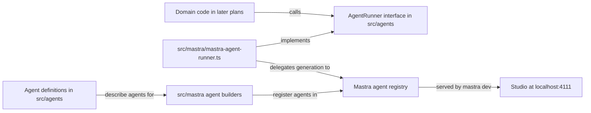

# Run one specialized researcher in Mastra Studio

## Summary

Create a small, standalone TypeScript application with one named Knowledge Researcher agent, and run it in Mastra Studio. Its identity lives in an ordinary Markdown file that is easy to inspect and edit. A thin, project-owned agent layer sits between application code and Mastra, so the agent framework can be replaced later without rewriting domain code.

## Context

This repository is a new experiment, separate from RoboRepo and youtube-transcript-cli. Mastra is the initial agent runtime, but the project owns its agent instructions, agent definitions, and domain types.

Current state of the repository:

- It contains plan documents under `docs/plans/` and a `.gitignore` that ignores `.DS_Store`. There is no `package.json`, source code, README, or test setup.
- No agent application has been run locally.

This plan is the root of the backlog. Later plans build on what it creates:

| Later plan | Relies on from this plan |
| --- | --- |
| Use the existing YouTube CLI as a safe transcript tool (`12v3ljqo`) | `src/` layout, `README.md`, a working test command |
| Turn one transcript into verifiable research findings (`w6j1t8pq`) | `agents/knowledge-researcher/AGENT.md`, and the `AgentRunner` boundary for calling the researcher |
| Compare technologies using current primary sources (`pkxml601`) | The `agents/<agent-name>/AGENT.md` convention and the agent definition shape for a second agent |
| Coordinate two agents with an explicit review gate (`y9gc5tc0`) | `src/mastra/` as the only place that imports Mastra |

## Goals

- A local Studio session lists a Knowledge Researcher whose answers are visibly shaped by its identity, not a general assistant.
- The agent instructions live in `agents/knowledge-researcher/AGENT.md`, not inside framework configuration.
- Application code calls agents through a project-owned `AgentRunner` interface; only `src/mastra/` imports Mastra.
- The repository has working `typecheck` and `test` scripts that later plans extend.

## Non-goals

- Transcript processing, persistence, multi-agent execution, or a custom web interface.
- Agent tools of any kind, including shell, filesystem, or web access.
- Agent memory or conversation storage beyond what Studio needs to show traces.
- Wrapping Mastra's Studio, workflows, tracing, memory, or model router. Those stay Mastra-specific.
- A second runner implementation. The layer is shaped for one, but only the Mastra runner is built.

## Proposed design

### Two kinds of provider switch

| Switch | Handled by | Cost of switching |
| --- | --- | --- |
| Model provider (for example Anthropic to OpenAI) | Mastra's model router, reading a `provider/model-name` string | Change `KNOWLEDGE_RESEARCHER_MODEL` and the provider key |
| Agent framework (for example Mastra to another SDK) | The thin agent layer in this plan | Rewrite `src/mastra/` and any workflows; `src/agents/` and domain code stay unchanged |

### Ownership boundary



| Area | Owns | May import Mastra |
| --- | --- | --- |
| `src/agents/` | Agent definitions, the `AgentRunner` type, reading `AGENT.md`, resolving the model setting | No |
| `src/mastra/` | Turning definitions into Mastra agents, the Mastra-backed runner, the `Mastra` instance | Yes |
| Domain code (later plans) | Transcripts, research, knowledge | No; it receives an `AgentRunner` as a parameter |

The layer stays thin:

- `AgentRunner` has one method: `generate(agentId, prompt)` returning the response text. Later plans add options (such as a structured-output schema) only when they need them.
- The Mastra runner delegates directly to `mastra.getAgentById(...)` and the agent's generate call. It translates arguments and results; it does not reimplement retries, streaming, memory, or tracing.
- Domain code receives the runner as a parameter, so its tests can pass a fake runner and never call a model.

### Project layout

Files this plan creates or changes:

```text
package.json
package-lock.json
tsconfig.json
.gitignore                                  (extended; it exists already)
.env.example
README.md
agents/knowledge-researcher/AGENT.md
src/agents/definitions.ts
src/agents/agent-runner.ts
src/agents/instructions.ts
src/agents/instructions.test.ts
src/mastra/index.ts
src/mastra/agents/knowledge-researcher.ts
src/mastra/mastra-agent-runner.ts
src/mastra/mastra-agent-runner.test.ts
docs/smoke-tests/knowledge-researcher-studio.md
```

The scaffold may add further files (for example storage or observability setup in `src/mastra/index.ts`). Keep what Studio needs to show traces; remove example agents, tools, and workflows.

### Agent definitions and instructions

- `src/agents/definitions.ts` lists each agent as plain data: `id`, `name`, the repository-relative path to its `AGENT.md`, and the environment variable that holds its model string.
- `src/agents/instructions.ts` reads an agent's `AGENT.md` and resolves its model string. Both take explicit inputs (path, environment) so tests need no provider key.
- Instructions are read once when the agent is built. An edit to `AGENT.md` takes effect after restarting `mastra dev`; the README states this.
- Resolve the `AGENT.md` path from the project root, not from the compiled module's location. `mastra dev` bundles source into a build directory, so a path relative to the module file can break.

### Identity content

`AGENT.md` is short and tells the researcher to separate four kinds of output: claims, the evidence for each claim, open questions, and recommendations. It says that unsupported statements are labeled as unverified rather than asserted.

### Model configuration

The model is a Mastra model-router string (`provider/model-name`) read from the `KNOWLEDGE_RESEARCHER_MODEL` environment variable. The provider key uses Mastra's standard variable for that provider (for example `ANTHROPIC_API_KEY`). A missing model setting fails at startup with an error that names the variable. No keys appear in source or in `.env.example`.

### Tooling decisions

| Choice | Decision |
| --- | --- |
| Package manager | npm, with `package-lock.json` committed |
| Scaffold location | Repository root; `create mastra` makes a new directory, so scaffold there and move the files up |
| Test runner | Vitest, run by `npm test`; tests never call a model |
| Typecheck | `npm run typecheck` running `tsc --noEmit` |
| Ignored files | Add `.env`, `node_modules/`, and Mastra build output to the existing `.gitignore`; keep its `.DS_Store` entry |

### Reconciliation with the orchestration plan

The orchestration plan (`y9gc5tc0`) says not to create a universal runtime adapter, and to isolate Mastra-specific composition in `src/mastra/workflows/`. This plan stays within that rule: `AgentRunner` covers single agent calls only, and workflows remain Mastra-specific under `src/mastra/`. When that plan is promoted, its domain steps should call agents through `AgentRunner`; its text needs no change now.

## Implementation checklist

- [ ] Scaffold a TypeScript Mastra project with `npm create mastra@latest`, move it to the repository root, and record the installed Mastra package versions and Node requirement in `README.md`.
- [ ] Remove the scaffold's example agents, tools, and workflows so the Knowledge Researcher is the only registered agent and has no tools.
- [ ] Extend `.gitignore`; add `typecheck` and `test` (Vitest) scripts; confirm both run on the empty project.
- [ ] Create `src/agents/` with the agent definition, the `AgentRunner` type, and the instruction and model loaders, with no Mastra imports.
- [ ] Write `agents/knowledge-researcher/AGENT.md`; build and register the Mastra agent from its definition in `src/mastra/`.
- [ ] Implement the Mastra-backed `AgentRunner` as a direct delegation to the registered agent.
- [ ] Add `.env.example` listing `KNOWLEDGE_RESEARCHER_MODEL` and the provider key name with placeholder values.
- [ ] Add the Vitest tests listed under Validation.
- [ ] Start Studio with `npm run dev`, submit the fixed prompt below, and record the result in `docs/smoke-tests/knowledge-researcher-studio.md`.
- [ ] Edit one rule in `AGENT.md`, restart, resubmit the same prompt, and record the difference in the same file.
- [ ] Write the README setup, environment, agent-layer, and smoke-test sections.

Fixed smoke-test prompt:

```text
A video claims that Mastra workflows replace the need for a job queue. Assess this claim.
```

The smoke-test record lists the date, Mastra version, model string, the prompt, a response excerpt, and the Studio trace ID or a screenshot of the trace.

## Validation

| Check | How it is verified |
| --- | --- |
| Instructions come from `AGENT.md` | Vitest: the instruction loader returns a fixture file's text, and two different fixture files produce two different results |
| Missing model fails clearly | Vitest: resolving the model without `KNOWLEDGE_RESEARCHER_MODEL` throws an error naming the variable |
| Runner delegates to Mastra | Vitest: the Mastra runner, given a `Mastra` instance whose agent returns a canned response, returns that text for the agent's id and rejects an unknown id; no model is called |
| `src/agents/` is framework-free | `grep -rn "@mastra" src/agents` prints nothing |
| Editing `AGENT.md` changes the agent | Manual: the before/after smoke-test responses differ |
| Studio lists the researcher | Manual: `npm run dev` shows Knowledge Researcher as the only agent, with no tools |
| A run produces a trace | Manual: the smoke-test record includes a trace ID or screenshot |
| Project health | `npm run typecheck` and `npm test` pass |
| No secrets committed | `git status` shows `.env` ignored; `.env.example` holds placeholders only |

## Risks

- Framework APIs change between releases. Verify the installed Mastra version's docs before implementing, and do not copy older examples.
- The default scaffold may wire in tools such as shell or web access. Remove them; the researcher has no tools in this plan.
- `mastra dev` runs bundled output. If reading `AGENT.md` from the project root fails under `mastra dev`, record the cause and the chosen fix in the decision log.
- Studio trace display may need storage or observability settings from the scaffold. Keep the minimum that shows a trace.
- An agent layer can grow into a second framework. Add a runner option only when a plan needs it, and keep anything Mastra already does on the Mastra side.
- Stubbing the agent's response in the runner test depends on the installed Mastra version. If the agent cannot be given a canned response without a network call, record the approach used in the decision log.

## Learning focus

Understand an agent identity, model configuration, a run, and a trace before introducing orchestration, and see where the project's code ends and the framework begins.

## Review checkpoint

Can you show how changing only `AGENT.md` changes the agent's response to the same prompt, and point to the one folder you would rewrite to change frameworks?

## Documentation impact

- Create `README.md` with prerequisites (Node version), installation, environment variables, the Studio start command, the restart-after-editing-`AGENT.md` note, the agent-layer boundary (`src/agents/` versus `src/mastra/`), and the smoke-test steps.
- Create `docs/smoke-tests/knowledge-researcher-studio.md` with the recorded smoke-test result.

## Decision log

- 2026-10-31: npm, Vitest, and a root-level scaffold chosen so later plans inherit one test command and layout.
- 2026-10-31: Instructions load once at agent initialization; a restart picks up `AGENT.md` edits.
- 2026-10-31: Model set by `KNOWLEDGE_RESEARCHER_MODEL` as a Mastra model-router string; no default model is hard-coded.
- 2026-10-31: A thin `AgentRunner` interface and framework-free agent definitions in `src/agents/` keep the agent framework replaceable. The user chose this over definitions-only so domain code can be tested with a fake runner.

## References

- <https://mastra.ai/docs>
- <https://mastra.ai/docs/studio/overview>
- <https://mastra.ai/docs/agents/overview>
- <https://mastra.ai/reference/agents/agent>
- <https://mastra.ai/docs/getting-started/installation>
