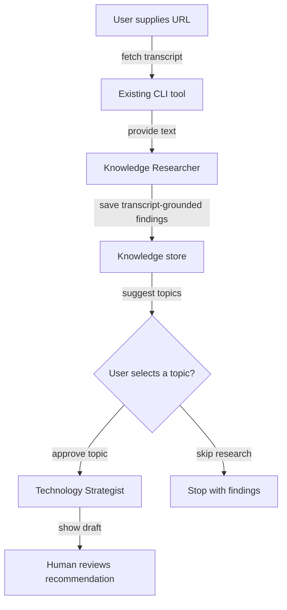

# Coordinate two agents with an explicit review gate

## Summary

Add a bounded collaboration path, without allowing agents to initiate unrestricted work or change the repository.

## Context

The researcher extracts themes and the strategist evaluates technologies; each is useful alone. Coordination should be visible, repeatable, and limited to a clear trigger.

## Goals

- One user action processes a YouTube URL and saves evidence-backed findings.
- The strategist runs only for an explicitly selected topic or user-approved suggestion.
- Reviewers can inspect each agent’s intermediate output before accepting a recommendation.

## Non-goals

- Autonomous scheduled browsing, background execution without user action, or automatic code edits.

## Proposed design

Use a Mastra workflow as the coordinator; keep transcript retrieval and persistence as deterministic functions. Keep both agents individually callable for learning. Proposed sequence:

Do not create a universal runtime adapter. Keep domain operations typed and framework-independent; isolate Mastra-specific composition to `src/mastra/workflows/`.

Models: each agent in the workflow keeps its own use-case variable (`RESEARCH_MODEL` for the researcher, `STRATEGY_MODEL` for the strategist) over the shared provider connection (`MODEL_API_KEY`, optional `MODEL_BASE_URL`). The review gate here is human. `.env.example` also reserves `REVIEW_MODEL` (planned: DeepSeek Flash, a different model family for a second opinion on important decisions); adding an automated second-opinion step would be a scope change for this plan, not an assumption of it.

## Implementation checklist

- [ ] Implement a single URL-to-analysis workflow using existing functions.
- [ ] Add a user-controlled branch that invokes the strategist only for an approved topic.
- [ ] Expose intermediate results and errors in Studio; persist only completed, validated domain records.
- [ ] Run one complete flow and record decision points for review.

## Validation

- A video can be processed end-to-end once with visible step outputs.
- Declining strategist research incurs no strategist model call.
- A failed transcript fetch stops analysis; a failed strategist search leaves the existing video record intact.

## Risks

Workflow APIs vary by Mastra version. Verify suspend/resume or human-approval support before choosing an implementation; use a simple two-command manual gate if easier.

## Learning focus

Observe the distinction between orchestration, tool execution, agent reasoning, and human approval.

## Review checkpoint

Can you show the two agents doing distinct work, and the exact point where you approve further research?

## Documentation impact

Add a simple workflow diagram and operating instructions to `README.md`.

## References

- <https://mastra.ai/docs/workflows/overview>
- <https://mastra.ai/docs/studio/overview>
