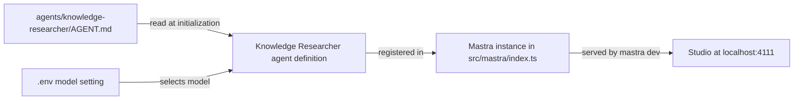

# Run one specialized researcher in Mastra Studio

## Summary

Create a small, standalone TypeScript application with one named Knowledge Researcher agent, and run it in Mastra Studio. Its identity lives in an ordinary Markdown file that is easy to inspect and edit.

## Context

This repository is a new experiment, separate from RoboRepo and youtube-transcript-cli. Mastra is the initial agent runtime, but the project owns its agent instructions and domain types.

Current state of the repository:

- It contains only plan documents under `docs/plans/`. There is no `package.json`, source code, README, `.gitignore`, or test setup.
- No agent application has been run locally.

This plan is the root of the backlog. Later plans build on what it creates:

| Later plan | Relies on from this plan |
| --- | --- |
| Use the existing YouTube CLI as a safe transcript tool (`12v3ljqo`) | `src/` layout, `README.md`, a working test command |
| Turn one transcript into verifiable research findings (`w6j1t8pq`) | `agents/knowledge-researcher/AGENT.md` and the registered researcher agent |
| Compare technologies using current primary sources (`pkxml601`) | The `agents/<agent-name>/AGENT.md` convention for a second agent |

## Goals

- A local Studio session lists a Knowledge Researcher whose answers are visibly shaped by its identity, not a general assistant.
- The agent instructions live in `agents/knowledge-researcher/AGENT.md`, not inside framework configuration.
- The repository has working `typecheck` and `test` scripts that later plans extend.

## Non-goals

- Transcript processing, persistence, multi-agent execution, or a custom web interface.
- Agent tools of any kind, including shell, filesystem, or web access.
- Agent memory or conversation storage beyond what Studio needs to show traces.

## Proposed design

### Project layout

Files this plan creates (none exist yet):

```text
package.json
tsconfig.json
.gitignore
.env.example
README.md
agents/knowledge-researcher/AGENT.md
src/mastra/index.ts
src/mastra/agents/knowledge-researcher.ts
src/mastra/agents/knowledge-researcher.test.ts
docs/smoke-tests/knowledge-researcher-studio.md
```

The scaffold may add further files (for example storage or observability setup in `src/mastra/index.ts`). Keep what Studio needs to show traces; remove example agents, tools, and workflows.

### How the identity reaches Studio



- `src/mastra/agents/knowledge-researcher.ts` owns the agent: it reads `AGENT.md`, resolves the model setting, and exports the `Agent`. The file read and the model lookup take explicit inputs so tests can supply them without a provider key.
- `src/mastra/index.ts` only registers agents on the `Mastra` instance.
- Instructions are read once when the agent module initializes. An edit to `AGENT.md` takes effect after restarting `mastra dev`; the README states this.
- Resolve the `AGENT.md` path from the project root, not from the compiled module's location. `mastra dev` bundles source into a build directory, so a path relative to the module file can break.

### Identity content

`AGENT.md` is short and tells the researcher to separate four kinds of output: claims, the evidence for each claim, open questions, and recommendations. It says that unsupported statements are labeled as unverified rather than asserted.

### Model configuration

The model is a Mastra model-router string (`provider/model-name`) read from the `KNOWLEDGE_RESEARCHER_MODEL` environment variable. The provider key uses Mastra's standard variable for that provider (for example `ANTHROPIC_API_KEY`). A missing model setting fails at startup with an error that names the variable. No keys appear in source or in `.env.example`.

### Tooling decisions

| Choice | Decision |
| --- | --- |
| Package manager | npm, with `package-lock.json` committed |
| Scaffold location | Repository root; `create mastra` makes a new directory, so scaffold there and move the files up |
| Test runner | Vitest, run by `npm test`; tests never call a model |
| Typecheck | `npm run typecheck` running `tsc --noEmit` |
| Ignored files | `.env`, `node_modules/`, Mastra build output, `.DS_Store` |

## Implementation checklist

- [ ] Scaffold a TypeScript Mastra project with `npm create mastra@latest`, move it to the repository root, and record the installed Mastra package versions and Node requirement in `README.md`.
- [ ] Remove the scaffold's example agents, tools, and workflows so the Knowledge Researcher is the only registered agent and has no tools.
- [ ] Add `.gitignore`, `typecheck`, and `test` (Vitest) scripts; confirm both run on the empty project.
- [ ] Write `agents/knowledge-researcher/AGENT.md` and load it into the registered Knowledge Researcher agent, resolving the path from the project root.
- [ ] Read the model from `KNOWLEDGE_RESEARCHER_MODEL`; add `.env.example` listing it and the provider key name with placeholder values.
- [ ] Add `knowledge-researcher.test.ts` covering instruction loading and the missing-model error.
- [ ] Start Studio with `npm run dev`, submit the fixed prompt below, and record the result in `docs/smoke-tests/knowledge-researcher-studio.md`.
- [ ] Edit one rule in `AGENT.md`, restart, resubmit the same prompt, and record the difference in the same file.
- [ ] Write the README setup, environment, and smoke-test sections.

Fixed smoke-test prompt:

```text
A video claims that Mastra workflows replace the need for a job queue. Assess this claim.
```

The smoke-test record lists the date, Mastra version, model string, the prompt, a response excerpt, and the Studio trace ID or a screenshot of the trace.

## Validation

| Check | How it is verified |
| --- | --- |
| Instructions come from `AGENT.md` | Vitest: the agent built from a fixture instruction file reports that file's text through the installed Mastra version's instructions accessor; if none exists, assert on the loader's return value and record that in the decision log |
| Editing `AGENT.md` changes the agent | Vitest: two different instruction files produce two different agent instructions; manual: the before/after smoke-test responses differ |
| Missing model fails clearly | Vitest: loading without `KNOWLEDGE_RESEARCHER_MODEL` throws an error naming the variable |
| Studio lists the researcher | Manual: `npm run dev` shows Knowledge Researcher as the only agent, with no tools |
| A run produces a trace | Manual: the smoke-test record includes a trace ID or screenshot |
| Project health | `npm run typecheck` and `npm test` pass |
| No secrets committed | `git status` shows `.env` ignored; `.env.example` holds placeholders only |

## Risks

- Framework APIs change between releases. Verify the installed Mastra version's docs before implementing, and do not copy older examples.
- The default scaffold may wire in tools such as shell or web access. Remove them; the researcher has no tools in this plan.
- `mastra dev` runs bundled output. If reading `AGENT.md` from the project root fails under `mastra dev`, record the cause and the chosen fix in the decision log.
- Studio trace display may need storage or observability settings from the scaffold. Keep the minimum that shows a trace.

## Learning focus

Understand an agent identity, model configuration, a run, and a trace before introducing orchestration.

## Review checkpoint

Can you show how changing only `AGENT.md` changes the agent's response to the same prompt?

## Documentation impact

- Create `README.md` with prerequisites (Node version), installation, environment variables, the Studio start command, the restart-after-editing-`AGENT.md` note, and the smoke-test steps.
- Create `docs/smoke-tests/knowledge-researcher-studio.md` with the recorded smoke-test result.

## Decision log

- 2026-10-31: npm, Vitest, and a root-level scaffold chosen so later plans inherit one test command and layout.
- 2026-10-31: Instructions load once at agent initialization; a restart picks up `AGENT.md` edits.
- 2026-10-31: Model set by `KNOWLEDGE_RESEARCHER_MODEL` as a Mastra model-router string; no default model is hard-coded.

## References

- <https://mastra.ai/docs>
- <https://mastra.ai/docs/studio/overview>
- <https://mastra.ai/docs/agents/overview>
- <https://mastra.ai/reference/agents/agent>
- <https://mastra.ai/docs/getting-started/installation>
